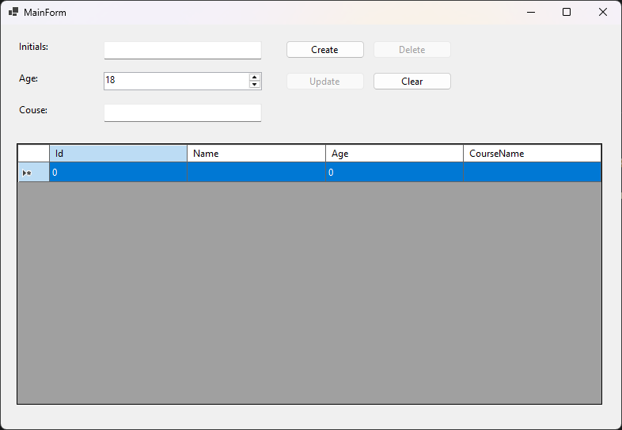
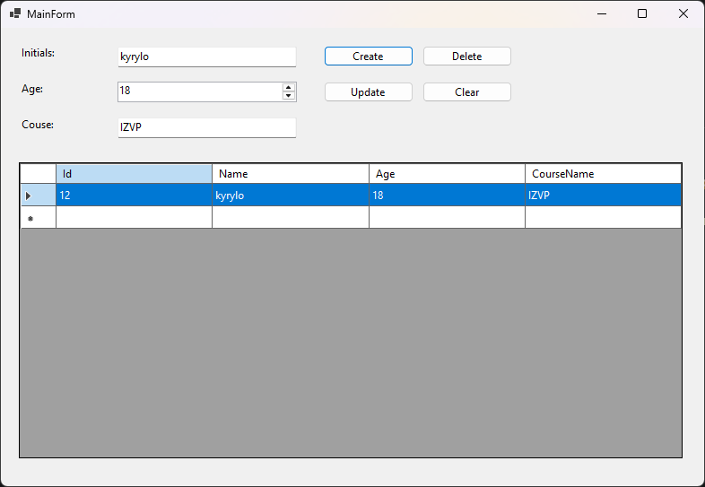


# Пояснення до практичих

---

## Практична 11

1. що означає CRUD
	- Create, Read, Update, Delete. Акронім який описує чотири основних операції для роботи з постійним сховищем.
2. як GUI взаємодіє з базою даних
	- Користувач натискає на кнопку GUI -> Кнопка повідомляє про евент -> евент викликає відповідний метод на базу даних.
3. якими SQL-запитами реалізуються основні операції 
	- Create -> CREATE TABLE або INSERT INTO. Read -> SELECT. Update -> UPDATE. Delete -> DELETE.
4. як забезпечується оновлення інтерфейсу після зміни дани
	- Через DataBinding.

---

## Практична 12

1. яка модель даних використовується
	- Використовується модель Student яка має 4 властивості: id, initals, age, course.
2. які властивості моделі зв’язані з елементами інтерфейсу
	- Всі 4 властивості з'являються в таблиці й всі властивості окрім id мають своє поле вводу.
3. який механізм Data Binding використано
	- Використано механізм зв'язування списку даних через колекцію, яка призначена для підключення об'єктів до елементів відображення.
4. як відбувається оновлення даних та інтерфейсу
	- Об'єкт із новими даними передається в репозиторій для збереження, після чого викликається відповідний метод. Він заново витягує оновлений список з бази даних та переприсвоює його в таблицю.
5. чим Data Binding відрізняється від ручного присвоєння значень елементам GUI
	- Замість ручного заповнення кожного слота просто зв'язується джерело даних з елементами інтерфейсу. Таблиця сама розподіляє інформацію за колонками й рядками.

---

1. Знімок екрану початкового стану програми

2. Знімок екрану після зміни даних

3. Запобігається некоректне введеня символів в поле Age завдяки елементу інтерфейсу NumericUpDown