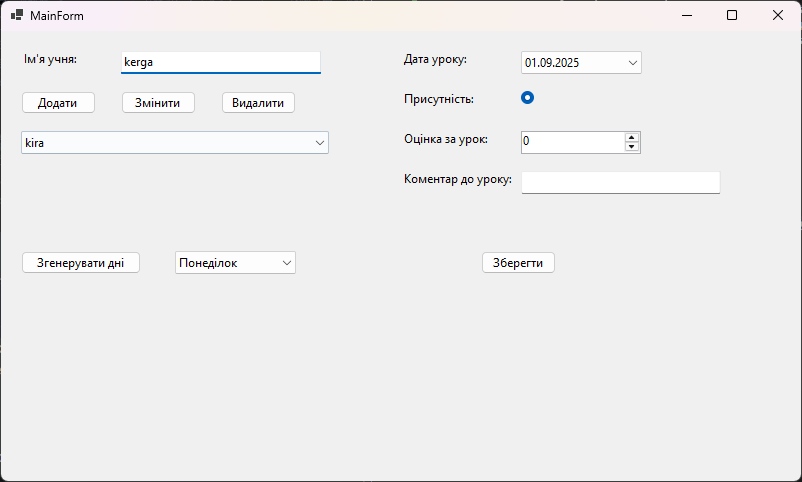
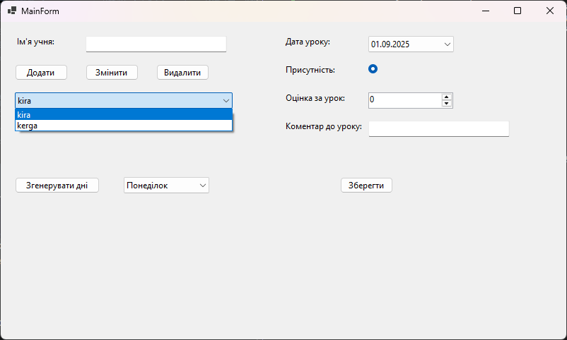
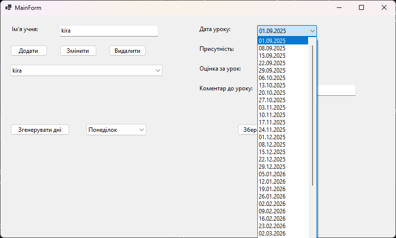
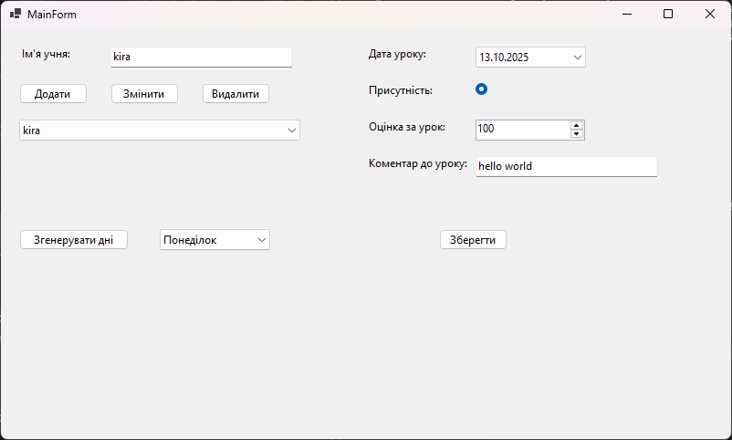
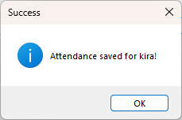
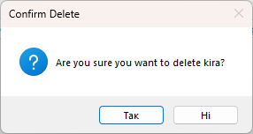
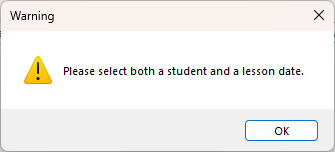


# Пояснення до практичих

---

## Практична 13

1. Яка логіка винесена у сервіс і чому її не слід залишати в обробнику кнопки?
	- У сервіс винесено розрахунок та автогенерацію дат уроків на весь навчальний рік (LessonService). Це розмежовує відповідальність (SoC), дозволяє повторно використовувати бізнес-логіку та робить її незалежною від графічного інтерфейсу та елементів Forms.
2. Як дані передаються з GUI до сервісу та результат повертається у вікно?
	- GUI зчитує обрані значення з контролів (наприклад, рік та DayOfWeek з ComboBox) і передає їх параметрами у відповідний метод сервісу. Сервіс генерує та зберігає дані в БД, після чого GUI викликає метод оновлення джерела даних (LoadDataLessons), оновлюючи прив'язку ComboBox.

---

## Практична 14

1. Які класи виконують ролі Model, View та Controller або ViewModel?
	- Model: класи сутностей (Student, Lesson, AttendanceRecord) та репозиторії даних; View: форма WinForms (MainForm); Controller / Service: сервісний шар (LessonService), який керує бізнес-логікою та взаємодією між UI і репозиторіями.
2. Як дія користувача «Змінити статус» доходить до моделі й оновлює вікно?
	- Користувач взаємодіє з елементами форми (стан RadioButton/NumericUpDown) і натискає кнопку «Зберегти», що викликає обробник події btnSave_Click. Обробник формує об'єкт AttendanceRecord, передає його в AttendanceRepository.Save(), після чого оновлює UI за допомогою LoadDataAttendanceRecord().

---

1. Знімок екрану початкового стану програми.

2. Додано нового учня. Список учнів.

3. Список згенерованих уроків від 09.2025 до 06.2026 на вибраний день (понеділок).

4. Присутність, оцінку та коментар уроку для певного учня на певний день.

5. Підтвердження після збереження інформації учня за урок.

6. Підтвердження про видалення учня.

7. Попереджнення при некоректному виборі поля учня чи урока.

