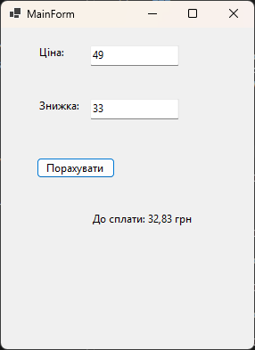
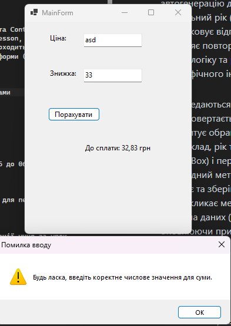
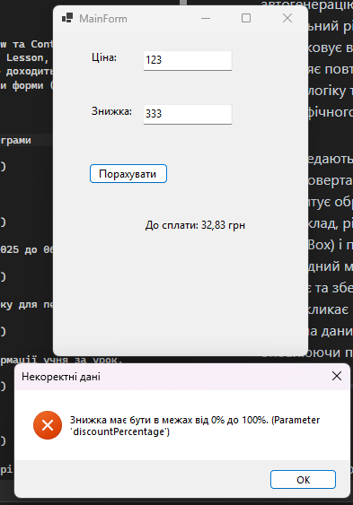


# Пояснення до практичих

---

## Практична 13

1. Яка логіка винесена у сервіс і чому її не слід залишати в обробнику кнопки?
	- У сервіс DiscountCalculatorService винесено бізнес-логіку обчислення підсумкової ціни та валідацію вхідних обмежень. Це розмежовує відповідальність (SoC), дозволяє повторно використовувати бізнес-логіку та робить її незалежною від графічного інтерфейсу та елементів Forms.
2. Як дані передаються з GUI до сервісу та результат повертається у вікно?
	- GUI зчитує значення з полів для тексту (ціна й знижка) і передає їх параметрами у відповідний метод сервісу. Сервіс здійснює необхідну бізнес-логіку з данми (обраховує знижку) й повертає результат в GUI для виводу інформації.

---

1. Знімок екрану роботи програми.

2. Обробка некоректних даних.

3. Обробка неправильного значення.

