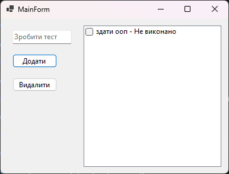
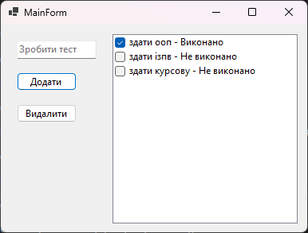
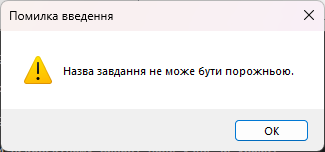
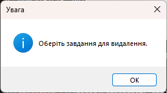
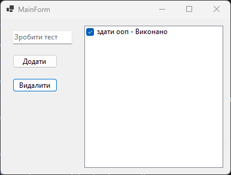


# Пояснення до практичих

---

## Практична 14

1. Які класи виконують ролі Model, View та Controller або ViewModel?
	- Model: клас TaskItem, який зберігає назву завдання (Name) і його статус (Completed), а також формує текстове представлення завдання (DisplayText).
	- View: форма MainForm, яка відображає список завдань, обробляє натискання кнопок і показує повідомлення користувачу.
	- Controller: клас TaskController, який зберігає колекцію завдань і реалізує логіку їх додавання, видалення та зміни статусу.
2. Як дія користувача «Змінити статус» доходить до моделі й оновлює вікно?
	- Користувач змінює стан прапорця у CheckedListBox, що викликає подію ListTasks_ItemCheck у формі MainForm. Обробник передає вибране завдання та новий статус у метод SetTaskCompleted() класу TaskController. Контролер оновлює властивість Completed відповідного об'єкта TaskItem. Після оновлення списку форма відображає актуальний статус завдання за допомогою методу RefreshTaskList().

---

1. Додано завдання.

2. Додано ще два завдання. Одне відмічено як виконане.

3. Спроба додати завдання без назви.

4. Спроба видалити завдання не вибравши його.

5. Програма після видалення двох завдань.

