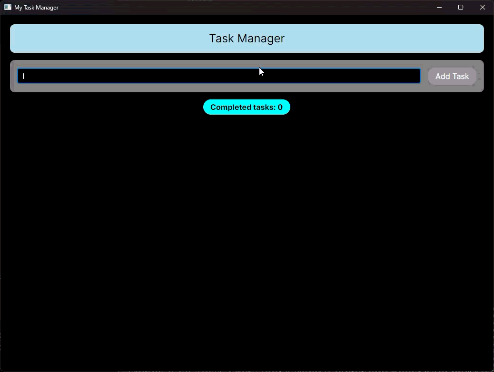


# Пояснення до практичих

---

## Практична 15

1. Що означає кросплатформність програмного забезпечення?
	- Кросплатформність - це здатність програмного забезпечення працювати на різних операційних системах без суттєвої зміни вихідного коду.
2. Для чого використовується Avalonia UI?
	- Для розробки сучасних графічних інтерфейсів у застосунках на платформі .NET.
3. Чим Avalonia UI відрізняється від Windows Forms?
	- Window Forms є платформозалежною технологією, яка використовує вбудовані системні компоненти Windows. Avalonia UI не має такої залежності, вона самостійно рендерить усі візуальні елеенти інтерфейсу на кросплатформному рушії Skia.
4. Як у C# обробляються події елементів графічного інтерфейсу?
	- Обробка базується на механізмі делегатів. Коли відбувається певна дія, елемент генерує подію. До цієї події підписуються методи обробники.
5. Яким чином можна відокремити логіку застосунку від графічного інтерфейсу?
	- Використовуючі архітектурні патерни (MVVM, MVC).

## Практична 16

1. Які два компоненти Avalonia UI ви створили та яку роль вони виконують?
	- Було створено два компоненти:
		1. TaskActionButton - кнопка для виконання дії над завданням (видалення або завершення).
		1. TaskCard - картка завдання, яка відображає текст завдання та кнопки дій.
2. Які дані передаються до компонентів через властивості або прив’язку?
	- В TaskActionButton передається текст кнопки, команда дії та сам об'єкт завдання як параметр. В TaskCard передається об'єкт TaskItem, з якого беруться рядок статусу та стан.
3. Як дія з компонента змінює стан завдання в основному застосунку?
	- Кнопка викликає команду з MainViewModel, передаючи їй конкретний TaskItem через CommandParameter.
4. Де в коді видно повторне використання компонентів без дублювання?
	- <local:TaskCard /> використовується в ListBox.ItemTemplate, що дозволяє відображати кожне завдання у вигляді картки без дублювання коду.
	- <local:TaskActionButton /> використовується в TaskCard для різних кнопок.

---

1. Запис роботи застосунку

