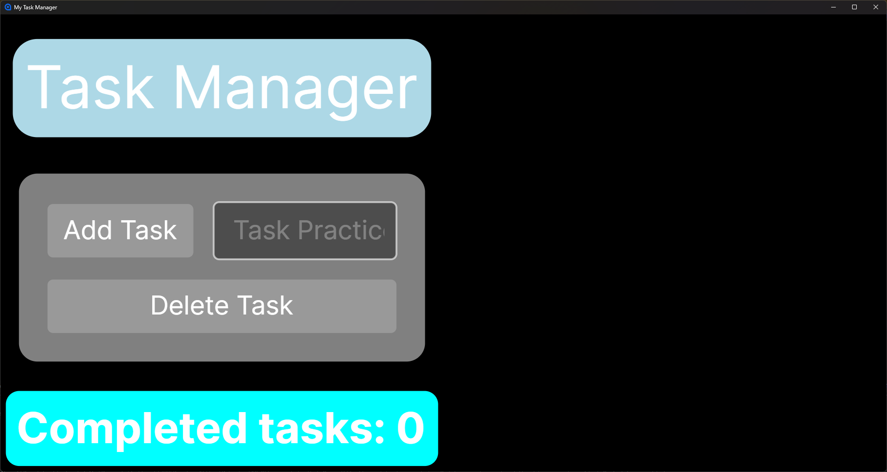
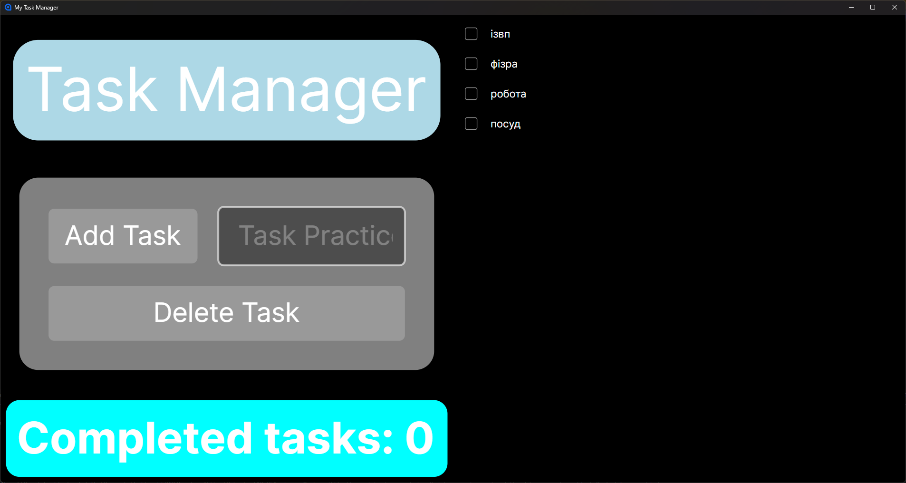
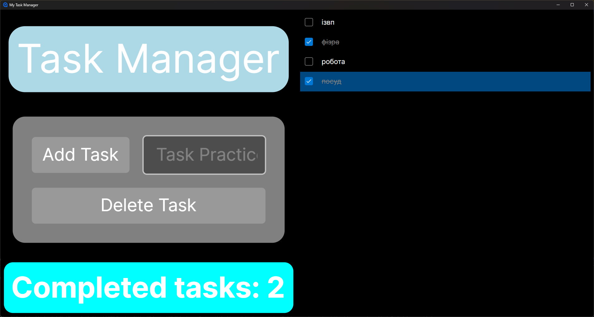
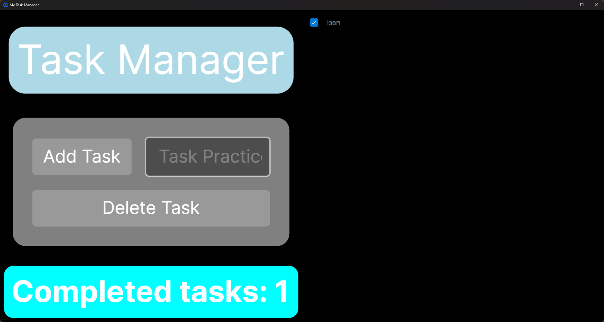


# Пояснення до практичих

---

## Практична 15

1. Що означає кросплатформність програмного забезпечення?
	- Кросплатформність - це здатність програмного забезпечення працювати на різних операційних системах без суттєвої зміни вихідного коду.
2. Для чого використовується Avalonia UI?
	- Для розробки сучасних графічних інтерфейсів у застосунках на платформі .NET.
3. Чим Avalonia UI відрізняється від Windows Forms?
	- Window Forms є платформозалежною технологією, яка використовує вбудовані системні компоненти Windows. Avalonia UI не має такої залежності, вона самостійно рендерить усі візуальні елеенти інтерфейсу на кросплатформному рушії Skia.
4. Як у C# обробляються події елементів графічного інтерфейсу?
	- Обробка базується на механізмі делегатів. Коли відбувається певна дія, елемент генерує подію. До цієї події підписуються методи обробники.
5. Яким чином можна відокремити логіку застосунку від графічного інтерфейсу?
	- Використовуючі архітектурні патерни (MVVM, MVC).

---

1. Початковий стан застосунку.

2. Додано завдання.

3. Завдання відмічені як виконані.

4. Видалення завдавнь.
